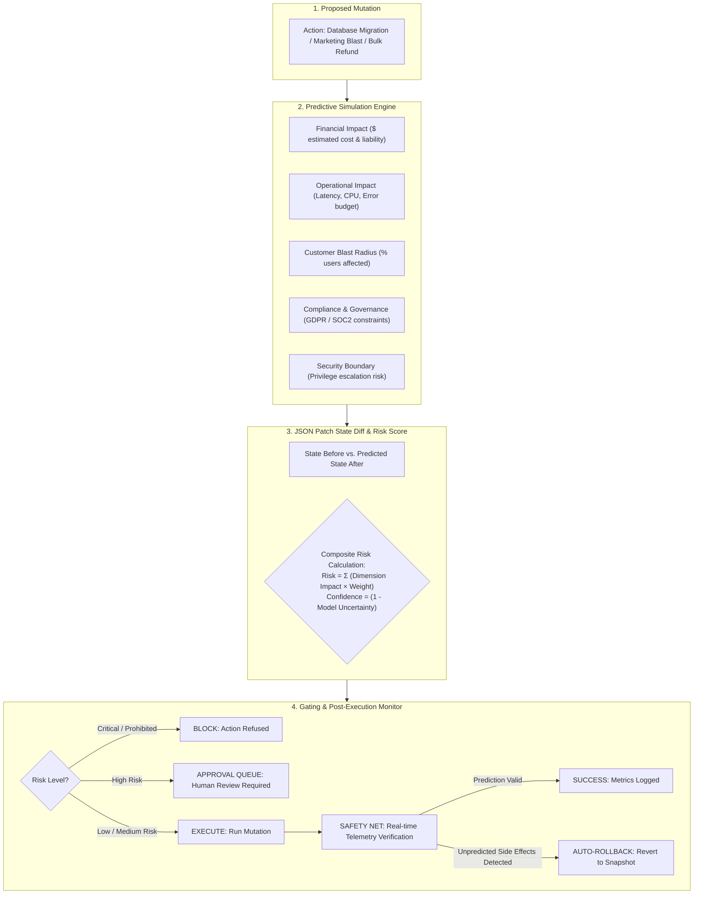

# Architecture Snapshot: PredictFlow AI

> **Intent → Simulate → Present → Execute / Auto-Rollback**

PredictFlow AI implements a mandatory pre-execution simulation gate and continuous post-execution safety net for any autonomous agent action that mutates systems.

---

## 1. High-Level Flow: Intent to Execution & Safety Net

```
┌────────────────────────────────────────────────────────────────────────┐
│                        PREDICTFLOW ARCHITECTURE                        │
│                                                                        │
│   ┌──────────────┐     ┌──────────────────┐     ┌──────────────────┐   │
│   │ 1. INTENT    │────▶│ 2. SIMULATION    │────▶│ 3. PRESENT       │   │
│   │              │     │    ENGINE        │     │    (DIFF VIEW)   │   │
│   │ • User /     │     │ • 5-Dimension    │     │ • State Before/  │   │
│   │   Agent Goal │     │   Impact         │     │   After Diff     │   │
│   │ • Proposed   │     │ • Risk Scorer    │     │ • Risk Score &   │   │
│   │   Action     │     │ • Confidence     │     │   Blast Radius   │   │
│   └──────────────┘     └──────────────────┘     └────────┬─────────┘   │
│                                                          │             │
│                                                          ▼             │
│   ┌──────────────┐     ┌──────────────────┐     ┌──────────────────┐   │
│   │ 6. AUTO-     │◀────│ 5. POST-EXEC     │◀────│ 4. EXECUTION     │   │
│   │    ROLLBACK  │     │    SAFETY NET    │     │    GATE          │   │
│   │ • Instant    │     │ • Telemetry vs   │     │ • Block / Review │   │
│   │   Snapshot   │     │   Prediction Diff│     │ • Human Sign-off │   │
│   │   Restoration│     │ • Drift Detector │     │ • Safe Dispatch  │   │
│   └──────────────┘     └──────────────────┘     └──────────────────┘   │
└────────────────────────────────────────────────────────────────────────┘
```

---

## 2. Multi-Dimensional Impact & State Diff Pipeline



---

## 3. Deliberate Failure Scenarios & Safety Net Containment

The platform implements 3 deliberate failure test cases (`/failure-test`):

1. **Unpredicted Dependency Cascade**: An action predicted as isolated affects an undocumented downstream microservice. The safety net detects latency spiking above 500ms and triggers automatic rollback within 800ms.
2. **Hidden Rate Limit Exhaustion**: A simulated bulk notification underestimates external API rate limits. Telemetry catches HTTP 429 surges, pauses dispatch, and reverts queue state.
3. **Data Loss Anomaly**: A database cleanup script exceeds predicted row deletion count by $> 10\%$. Safety net halts execution and restores the pre-execution transaction snapshot.
